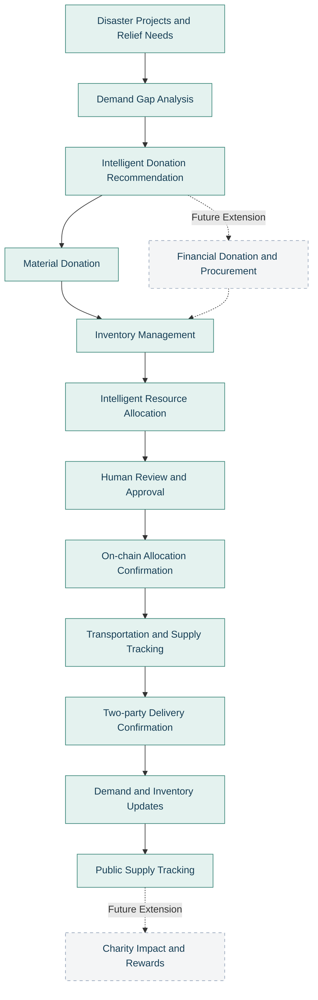

# AidTrace-Project
A Blockchain-Based Intelligent Disaster Relief and Donation Management System
# AidTrace

### A Blockchain-Based Intelligent Disaster Relief and Donation Management System

## 1. Project Overview

AidTrace is a proposed hybrid decentralized application (Hybrid dApp) that integrates traditional web technologies, Ethereum blockchain, and intelligent decision-making algorithms for disaster relief and donation management.

The platform connects donors, charity organizations, logistics providers, and relief centers to support demand publication, intelligent donation recommendations, resource allocation, supply tracking, and delivery confirmation.

Our goal is to improve the efficiency, transparency, trustworthiness, and fairness of disaster relief supply management.

## 2. Project Motivation

Disaster relief and donation management face several challenges:

- Mismatches between donated supplies and actual relief needs.
- Duplicate aid caused by insufficient coordination among organizations.
- Inefficient or unfair allocation of limited relief resources.
- Limited transparency in supply transportation and delivery.
- Inconsistent records among participating organizations.
- Insufficient feedback on donation outcomes.

AidTrace aims to address these challenges by combining demand-driven decision-making with blockchain-based business records and verification mechanisms.

## 3. Functional Modules

### 3.1 MVP Core Modules

#### Module 1 — Transparent and Trustworthy Relief Supply Management

- Disaster relief project management.
- Relief demand registration.
- Material donation registration.
- Inventory and batch management.
- Cross-organizational information sharing.
- Logistics and supply tracking.
- Two-party handover confirmation.
- Discrepancy reporting.
- Blockchain-based record verification.

#### Module 2 — Intelligent Donation and Resource Allocation

- Relief demand gap analysis.
- Intelligent donation recommendations.
- Duplicate aid warnings.
- Urgency-based demand prioritization.
- Resource allocation algorithms.
- Human review and approval of allocation plans.
- On-chain allocation confirmation.
- Comparison of planned and actual delivery.

### 3.2 Future Extensions

The following modules will be considered after the MVP has been implemented and tested.

#### Module 3 — Integrated Financial and Material Tracking

- Simulated financial donations.
- Budget and expenditure management.
- Procurement records.
- Financial-material linkage.
- Fund usage tracking.

#### Module 4 — Information Disclosure and Charity Incentives

- Donation impact feedback.
- Personal contribution statistics.
- Charity points.
- Digital donation certificates.
- Optional NFT-based charity credentials.

These two modules are not required for the MVP.

## 4. System Architecture

AidTrace adopts a hybrid architecture consisting of:

| Component | Responsibility |
|---|---|
| Web Application | User interaction and business operations |
| Backend and Database | Business logic and off-chain data management |
| Intelligent Algorithms | Demand analysis, recommendation, and allocation |
| Ethereum Smart Contracts | Access control, business rules, and verification |
| Cloud Infrastructure | Application and blockchain-related deployment |

The system combines on-chain and off-chain data management.

- On-chain: key business states, allocation records, role permissions, handover confirmations, and transaction events.
- Off-chain: detailed business information, documents, database records, and algorithmic computation.

Blockchain is used to improve the integrity and verifiability of recorded information. It does not automatically guarantee the accuracy of real-world data.

## 5. Business Workflow



## 6. Candidate Technology Stack

| Category | Candidate Technologies |
|---|---|
| Frontend | Vue.js / React |
| Backend | FastAPI / Node.js |
| Database | SQLite / MySQL |
| Blockchain | Ethereum |
| Smart Contracts | Solidity |
| Blockchain Development | Hardhat / Foundry |
| Contract Libraries | OpenZeppelin |
| Web3 Integration | ethers.js |
| Wallet | MetaMask |
| Data Processing | NumPy / Pandas |
| Recommendation | Python / scikit-learn |
| Optimization | SciPy / OR-Tools |
| Visualization | ECharts |
| Cloud Blockchain | To be determined |
| Version Control | GitHub |

The final technology stack will be determined after evaluating existing open-source projects and testing the development environment.

## 7. Development Roadmap

### Phase 1 — Minimum Viable Prototype (MVP)

- [ ] Step 1: Research and open-source project evaluation.
- [ ] Step 2: Development environment and project structure.
- [ ] Step 3: Basic blockchain demo.
- [ ] Step 4: Basic relief management system.
- [ ] Step 5: Smart contracts and trustworthy supply tracking.
- [ ] Step 6: On-chain and off-chain integration.
- [ ] Step 7: Intelligent donation recommendation.
- [ ] Step 8: Intelligent resource allocation.
- [ ] Step 9: MVP integration and testing.
- [ ] Step 10: Preliminary evaluation and deployment.

### Phase 2 — Future Extensions

- [ ] Integrated financial and material tracking.
- [ ] Information disclosure and charity incentives.
- [ ] Further system integration and evaluation.

## 8. Proposed Repository Structure

```text
AidTrace/
├── frontend/
├── backend/
├── blockchain/
│   ├── contracts/
│   ├── scripts/
│   └── test/
├── algorithms/
├── data/
├── tests/
├── docs/
│   ├── proposal/
│   ├── architecture/
│   ├── prototypes/
│   └── references/
├── README.md
└── .gitignore
```

This structure is preliminary and may be adjusted during implementation.

## 9. Related Work

The following systems and research projects provide initial references for AidTrace.

| Project | Reference |
|---|---|
| LSS/SUMA | [PAHO Humanitarian Supply Management](https://www.paho.org/en/topics/health-emergencies-and-disaster-response/lss-system) |
| WFP Building Blocks | [Official Website](https://www.wfp.org/building-blocks) |
| Sahana Eden | [GitHub Repository](https://github.com/sahana/eden) |
| Floodlight | [GitHub Repository](https://github.com/codeforpakistan/floodlight/) |
| SecureRelief | [Research Paper](https://doi.org/10.3390/systems14020171) |

Further literature review and open-source project evaluation will be conducted during development.

## 10. Project Documents and Collaboration

| Resource | Link |
|---|---|
| Project High-Level Plan | To be uploaded |
| Research Paper — Google Docs | To be added |
| Literature Review | To be added |
| System Architecture | To be uploaded |
| UI Prototypes | To be uploaded |
| Slack Workspace | To be added |

## 11. Team Members

| Member | Responsibility |
|---|---|
| Li Xinyan | Blockchain & Smart Contract Development |
| Li Xirun | Web Application Development |
| Liu Yimeng | Intelligent Algorithms & Data Analysis |

### Shared Responsibilities

- Literature review.
- Open-source project evaluation.
- System design.
- Integration and testing.
- Research paper writing.
- Final project presentation.

## 12. Getting Started

The project is currently in the planning and initial development stage.

Installation instructions, environment requirements, smart contract deployment procedures, and application startup commands will be added once the initial implementation is available.

## 13. Course Information

**Course:** Introduction to Ethereum and Cloud Blockchain Solutions Engineering

**Instructor:** Prof. Jean-Claude Franchitti

## Disclaimer

AidTrace is an academic research and prototype development project.

The initial prototype will use simulated disaster relief and donation data. It is not intended to manage real humanitarian funds or production-level disaster relief operations at this stage.
